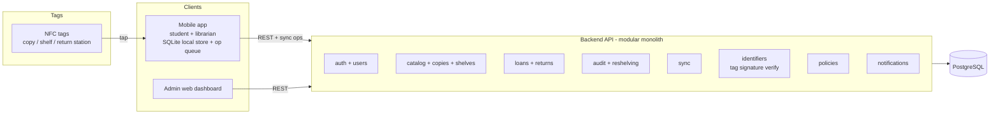

# Architecture overview (draft)

Style: **modular monolith** backend, offline-first mobile client. Stack choices are *proposed* (see ADRs).

## Module responsibilities (`services/api/src/modules`)

| Module | Owns |
| --- | --- |
| `auth`, `users` | JWT + refresh tokens, roles, device binding, bulk import (SSO-ready) |
| `catalog` | Titles, ISBNs, search |
| `shelves`, `copies` | Shelf addresses, copies, home shelf, last-seen shelf, copy state machine |
| `loans`, `returns` | Borrow/return rules, `return_pending`, due dates, fines |
| `audit` | Shelf audits, sweeps, reshelving queue, `UNACCOUNTED` detection |
| `sync` | Operation log intake, ordering, conflict resolution |
| `identifiers` | `BookIdentifier` implementations (NFC, QR, simulated), signature verification |
| `policies` | Loan period, limit, fine rate |
| `notifications` | Due-date reminders, receipts |

## Key flows

- **Borrow:** shelf tag tap, copy tap; server (or local rules offline) checks standing, fines, limit, availability and tag signature; loan created.
- **Return:** station tap, copy tap; loan becomes `return_pending`; confirmed by librarian scan or audit.
- **Offline borrow:** recorded locally as a provisional loan with the raw tap proof; server verifies on reconnect and confirms or rejects.

## Cross-cutting

- Consistency: Postgres transactions and row locking prevent double-loans.
- Sync contract and tag payload format live in `packages/`.
- Tests without hardware use a simulated identifier.

Decisions: see [docs/adr](../adr/). Threats: see [threat model](../threat-model/README.md).
