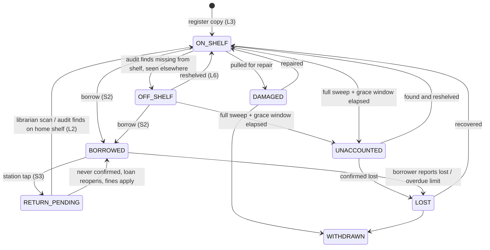

# Copy state machine (draft)

The project context models location as two zones (`IN_LIBRARY`, `BORROWED`). That leaves gaps, for example a returned-but-unconfirmed book. This draft makes status explicit so every transition is checkable. **Proposed, not yet agreed.**

## States

| State | Meaning |
| --- | --- |
| `ON_SHELF` | In the library, on its home shelf |
| `OFF_SHELF` | In the library, not on its home shelf (table, cart, wrong shelf); goes to the reshelving queue |
| `BORROWED` | Loaned to a student; allowed outside the library |
| `RETURN_PENDING` | Student tapped a return station; awaiting librarian scan or shelf-audit confirmation |
| `UNACCOUNTED` | Not borrowed, not found after a full sweep and the grace window (possible theft) |
| `LOST` | Confirmed lost (e.g. borrower reported, or unaccounted resolved as lost) |
| `DAMAGED` | Pulled from circulation for repair |
| `WITHDRAWN` | Permanently removed from the collection |

## Transitions

## Rules to enforce in code

- A copy in `BORROWED` has exactly one open loan; any other state has none.
- Only `ON_SHELF` and `OFF_SHELF` copies can be borrowed.
- Unborrowed copies may not leave the library (exit check, L7).
- Every transition writes an audit-log row (actor, time, reason).

## Still undefined

- Grace window length and its trigger (see [open questions](../open-questions.md))
- Fine handling when `RETURN_PENDING` reopens
